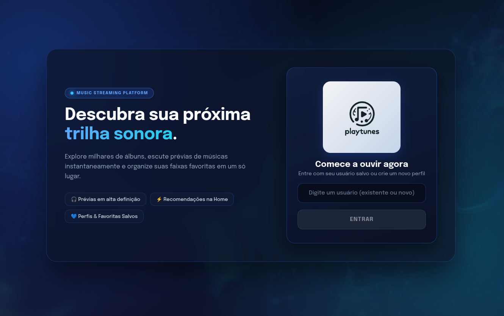
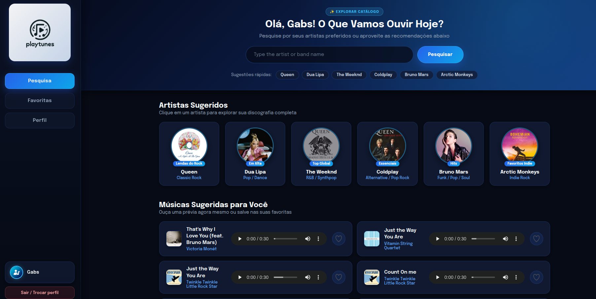
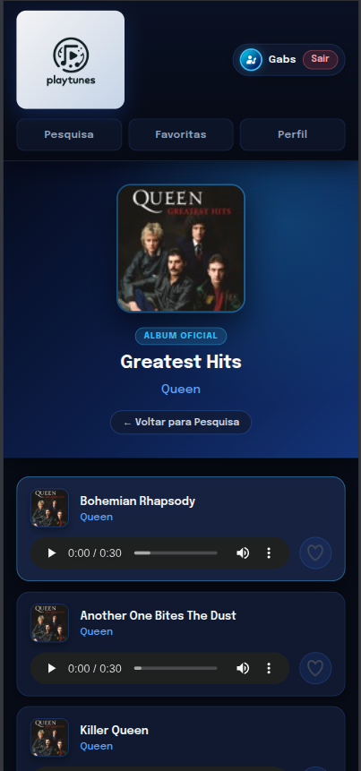
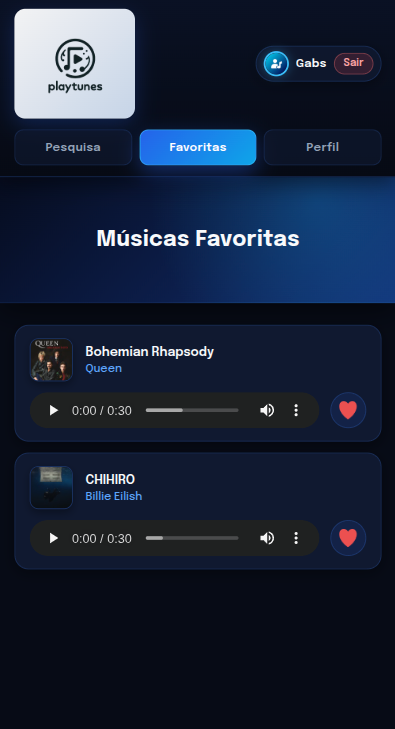
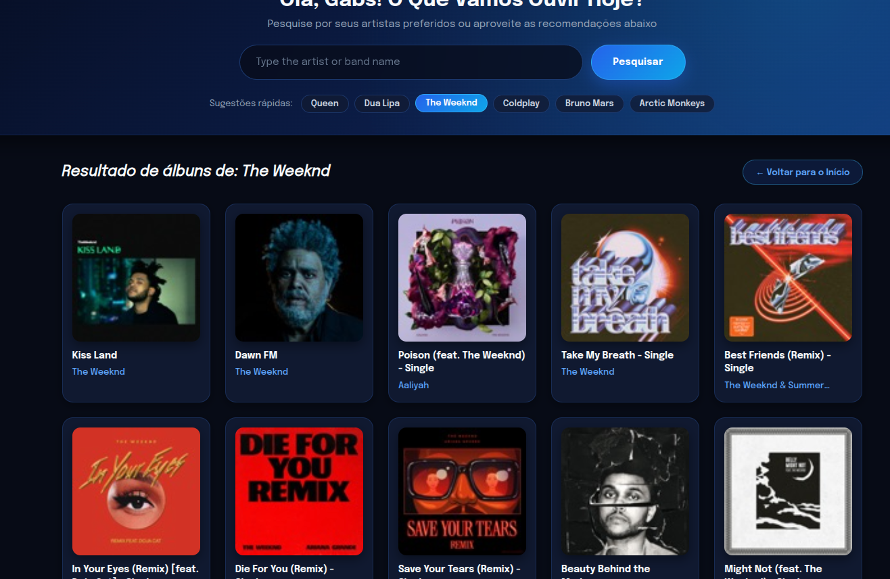

# 🎵 PlayTunes

[🚀 Live Demo](https://devgabrielav.github.io/playtunes/)

## 🎯 Project overview

PlayTunes is a music discovery and personal library application designed to help users explore artists, albums, and song previews in a simple and engaging interface. The app allows users to search for music, browse recommendations, manage favorite songs, and keep separate profile data for different people in the same browser experience.

## ✨ Features

- User login and profile switching
- Creation or reuse of saved profiles
- Search for artists and bands
- Album list and track details view
- Song preview playback from multiple screens
- Real-time favorite and unfavorite actions
- Personalized favorites list per user
- Profile viewing and editing with live preview
- Responsive layout for desktop and mobile devices

## 🧭 Main routes

- `/` — login screen when logged out, or home/discovery screen when logged in
- `/album/:id` — album details and track list with audio previews
- `/favorites` — saved favorite songs for the current user
- `/profile` — current user profile view
- `/profile/edit` — profile editing form

## 🛠️ Technologies

### Frontend
- TypeScript
- React 18
- Vite
- React Router DOM
- CSS3 with responsive design patterns

### Backend / data layer
- Apple Music / iTunes Search API
- JSONP fallback to handle CORS restrictions when loading album tracks
- Local Storage for user profiles and favorites persistence

### Tools and deployment
- GitHub Pages
- GitHub Actions
- React Spinners
- Validator

## ▶️ Run locally

1. Clone the repository:

```bash
git clone <repository-url>
cd playtunes
```

2. Install dependencies:

```bash
npm install
```

3. Start the development server:

```bash
npm run dev
```

## 📸 Screenshots

Desktop
<p align="center">
  
</p>
<p align="center">
  
</p>

Features
<table>
  <tr>
    <td align="center" width="50%">
      
    </td>
    <td align="center" width="50%">
      
    </td>
  </tr>
</table>

<p align="center">
  
</p>

## 🧩 Notes

The project is built as a frontend application with a focus on user experience, responsive design, and music discovery. It combines browsing, playback, favorites, and profile management in a single interface, making the experience feel like a lightweight streaming and library app.

